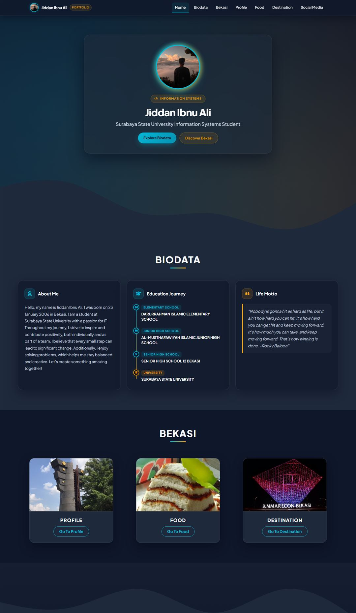
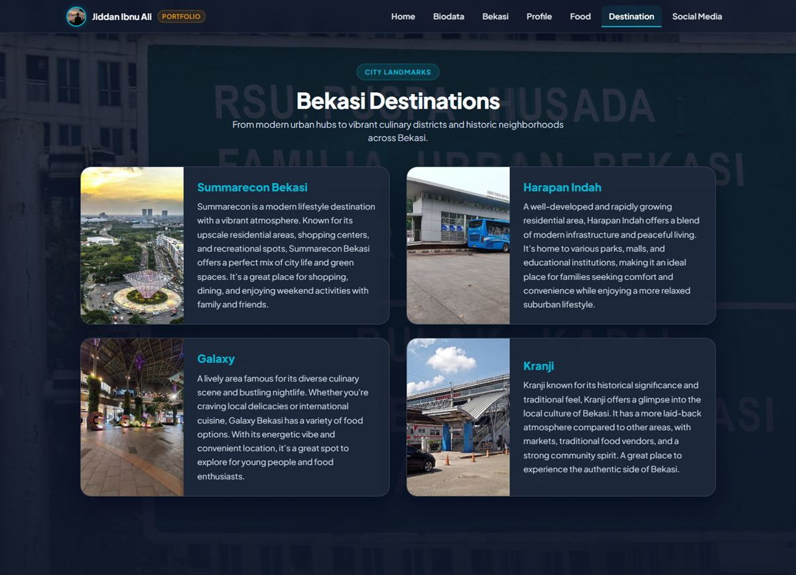

# Jiddan Portfolio (`jiddan-portfolio`)

A modernized personal portfolio and Bekasi city showcase built by **Jiddan Ibnu Ali** (Information Systems Student at Surabaya State University). Designed with a cohesive **Deep Slate & Patriot Cyan** visual language, glassmorphic navigation, vertical education timeline, and sub-300KB optimized assets for fast loading.

## 🌐 Live Demo (GitHub Pages)

- **Live Website:** [https://4jeeh.github.io/jiddan-portfolio/](https://4jeeh.github.io/jiddan-portfolio/)
- **Repository:** [https://github.com/4jeeh/jiddan-portfolio](https://github.com/4jeeh/jiddan-portfolio)

---

## 📸 Preview Screenshots

### Home & Biodata (`index.html`)


### Bekasi Destinations (`destination.html`)


---

## ✨ Key Features & Modernization Highlights

1. **Preserved 4-Page Core Architecture**
   - `index.html`: Hero profile introduction, 3-column Biodata section (About Me, Vertical Stepper Education Timeline, Life Motto), Bekasi overview cards, and Social Media links.
   - `profile.html`: Interactive glassmorphic accordion detailing Bekasi's history, the "Planet Bekasi" cultural phenomenon, and geographic profile.
   - `food.html`: Showcase of iconic Bekasi & Betawi culinary heritage (*Sayur Gabus Pucung*, *Kue Dongkal*, *Kue Rangi*, and *Sop Janda*).
   - `destination.html`: Highlighted city landmarks and districts (*Summarecon Bekasi*, *Harapan Indah*, *Galaxy*, and *Kranji*).

2. **Visual & Typography Harmonization**
   - **Color Palette:** Deep Slate (`#0F172A`), Dark Navy Surface (`#1E293B`), Patriot Cyan (`#06B6D4`), and Warm Amber (`#F59E0B`).
   - **Typography:** Modern Google Fonts pairing (`Plus Jakarta Sans` & `Inter`) across all pages.
   - **Glassmorphic Navigation:** Synchronized fixed-top navbar across all 4 pages with `backdrop-filter: blur(16px)`, high-contrast white links, active state indicators, and uniform brand avatar.
   - **Vertical Stepper Timeline:** Clean educational progression from Elementary School through Surabaya State University.

3. **Web Performance & Image Optimization**
   - All images in `image/` are compressed and optimized to **< 300 KB per file** (reducing total asset payload from >24 MB down to ~1.9 MB — over **92% reduction**).
   - High-resolution, authentic photos for Bekasi destinations and traditional foods with native lazy-loading (`loading="lazy" decoding="async"`).

---

## 📁 Project Structure

```text
jiddan-portfolio/
├── css/
│   ├── index.css          # Styles for Home, Biodata timeline, Bekasi cards & Footer
│   ├── profile.css        # Styles for Bekasi Profile & glassmorphic accordions
│   ├── food.css           # Styles for Bekasi traditional food showcase
│   └── destination.css    # Styles for Bekasi destination cards
├── image/                 # Optimized images (< 300 KB each)
├── index.html             # Main portfolio & biodata page
├── profile.html           # Bekasi city profile page
├── food.html              # Bekasi traditional culinary page
├── destination.html       # Bekasi popular destinations page
├── .gitignore             # Git ignore rules
├── LICENSE                # MIT License
└── README.md              # Project documentation
```

---

## 🚀 Running Locally

Clone the repository and serve the static files using any local HTTP server:

```bash
git clone https://github.com/4jeeh/jiddan-portfolio.git
cd jiddan-portfolio
python -m http.server 8090
```

Then open `http://localhost:8090` in your browser.

---

## 📄 License

Distributed under the **MIT License**. See [`LICENSE`](LICENSE) for more information.
