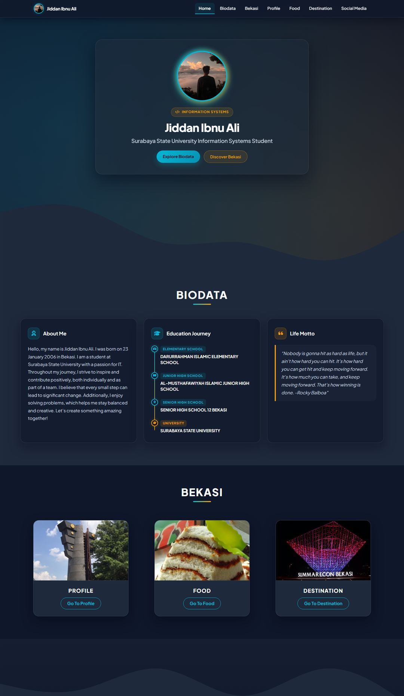
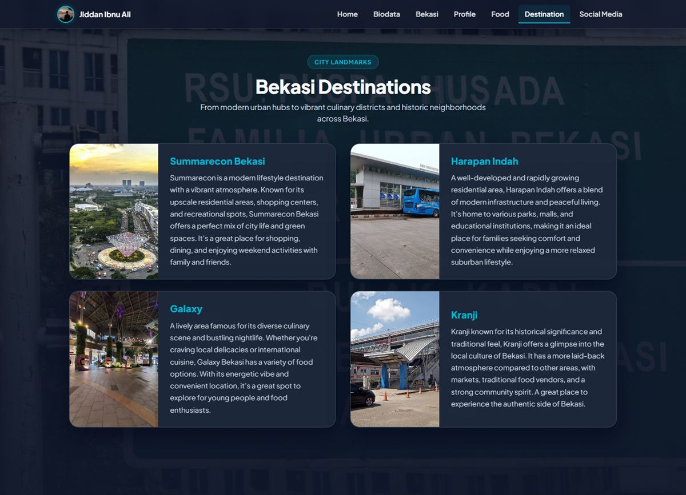

# Jiddan's Journey (`jiddan-journey`)

A personal website detailing the life journey, biodata, and Bekasi city exploration by **Jiddan Ibnu Ali** (Information Systems Student at Surabaya State University). Built with modern HTML5, Bootstrap 5, and customized glassmorphic CSS styled in a **Deep Slate & Patriot Cyan** color theme.

---

## 📖 About The Project

This website is dedicated to documenting Jiddan's personal life journey, education history, and showcasing the rich culture, cuisine, and landmarks of his hometown, **Bekasi City**. 

All 4 original core pages have been modernized with responsive layouts, high contrast readability, and optimized fast-loading assets:

1. **`index.html` (Home & Biodata)**
   - Hero section introducing Jiddan with his profile picture.
   - 3-column Biodata section: Personal bio, vertical stepper education timeline, and Rocky Balboa life motto.
   - Quick navigation cards to Bekasi sections and social media links.
2. **`profile.html` (Bekasi City Profile)**
   - Interactive accordion explaining the history of Bekasi City from the Tarumanegara era to modern times.
   - Commentary on the popular "Planet Bekasi" cultural meme.
   - Geographic context of Bekasi as a strategic satellite city.
3. **`food.html` (Bekasi Culinary Heritage)**
   - Authentic traditional culinary items: *Sayur Gabus Pucung*, *Kue Dongkal*, *Kue Rangi*, and *Sop Janda*.
4. **`destination.html` (Bekasi Destinations & Landmarks)**
   - Popular hubs and districts: *Summarecon Bekasi*, *Harapan Indah*, *Galaxy*, and *Kranji*.

---

## 📸 Preview Screenshots

### Home & Biodata (`index.html`)


### Bekasi Destinations (`destination.html`)


---

## ⚡ Key Highlights

- **Visual & Typography Harmonization:** Deep Slate (`#0F172A`), Dark Navy Surface (`#1E293B`), Patriot Cyan (`#06B6D4`), and Warm Amber (`#F59E0B`) with Google Fonts (*Plus Jakarta Sans* & *Inter*).
- **Glassmorphic Navigation:** Synchronized fixed-top navbar across all pages with `backdrop-filter: blur(16px)`, high-contrast white text, active page indicator, and brand avatar.
- **Vertical Stepper Timeline:** A structured vertical stepper timeline illustrating educational milestones.
- **Performance & Asset Compression:** 100% of image assets in `image/` are compressed to **< 300 KB per file** (reducing overall repository asset size from >24 MB to ~2 MB).
- **Interactive UI:** Smooth transitions, responsive card grids, and mobile-optimized layouts.

---

## 📁 Project Structure

```text
jiddan-journey/
├── css/
│   ├── index.css          # Styles for Home, Biodata timeline, Bekasi cards & Footer
│   ├── profile.css        # Styles for Bekasi Profile & glassmorphic accordions
│   ├── food.css           # Styles for Bekasi traditional food showcase
│   └── destination.css    # Styles for Bekasi destination cards
├── image/                 # Optimized images (< 300 KB each)
├── index.html             # Main journey & biodata page
├── profile.html           # Bekasi city profile page
├── food.html              # Bekasi traditional culinary page
├── destination.html       # Bekasi popular destinations page
├── .gitignore             # Git ignore rules
├── LICENSE                # MIT License
└── README.md              # Project documentation
```

---

## 💻 Running Locally

This project is intended to be run locally. Clone the repository and serve the static files with any local HTTP server:

```bash
git clone https://github.com/4jeeh/jiddan-journey.git
cd jiddan-journey
python -m http.server 8090
```

Then visit `http://localhost:8090` in your browser.

---

## 📄 License

Distributed under the **MIT License**. See [`LICENSE`](LICENSE) for details.
